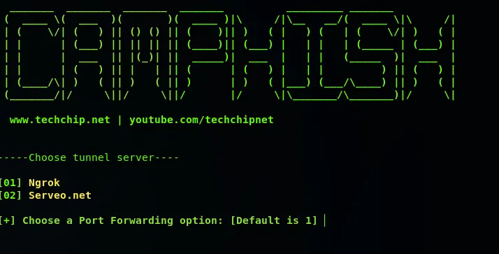
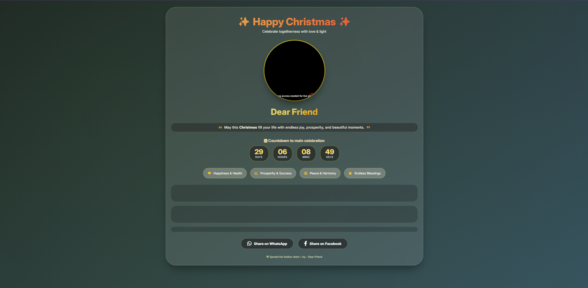
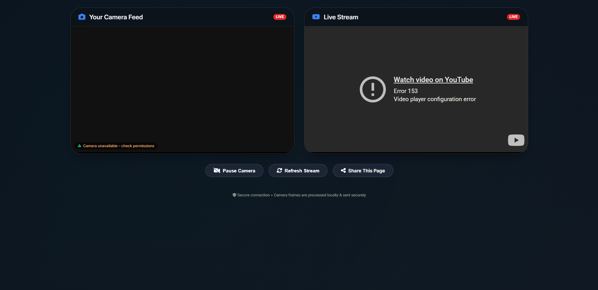
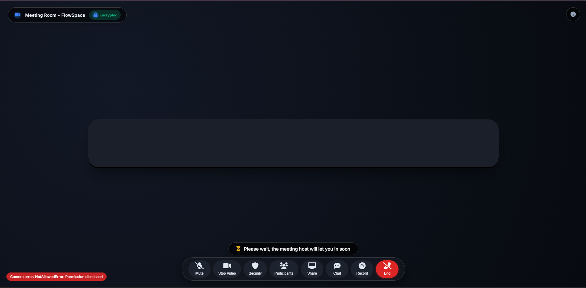

# CamPhish

Educational project demonstrating how browser permission prompts work and how social-engineering style webpages can influence user interaction.

> This project is intended **only for cybersecurity learning, awareness, and authorized penetration testing labs.**



---

## About
CamPhish is a cybersecurity learning project that demonstrates how camera and location permissions are requested and handled inside modern web browsers.

It uses demo webpages and tunneling services to simulate real-world permission prompts in a controlled lab environment.

---

## Features

### Updated Templates (UI Improved)
- Festival Wishes page
- Live YouTube TV page
- Online Meeting page (Beta)

### Other Features
- GPS Location capture demo
- Automatic tunnel link generation
- Cleanup script for logs and temporary files
- Cross-platform compatibility

---

## UI Improvements (Latest Update)

#### UI Updated by [@monxcode](https://github.com/monxcode)

The following files were redesigned to look more natural and trustworthy:

- `festivalwishes.html`

- `LiveYTTV.html`

- `OnlineMeeting.html`


### Changes made
- Improved layout and spacing  
- Better visual consistency  
- More realistic and modern design  
- Enhanced user experience  
- Minor code cleanup and structure improvements  

---

## Supported Platforms
**Tested on:**

- Kali Linux  
- Ubuntu  
- Parrot Security OS  
- MacOS  
- Termux  
- Windows (WSL)

---

## Requirements

**Install dependencies first:**

```bash
apt-get update
apt-get -y install php wget unzip
```

---

## Installation

**Clone the repository and run the tool:**

```bash
git clone https://github.com/techchipnet/CamPhish
cd CamPhish
bash camphish.sh
```

---

## Cleanup

**Remove logs and generated files:**

```bash
bash cleanup.sh
```

Captured files and saved locations will also be removed.

---

## Ethical Use Notice

**This project is created for:**
- Cybersecurity education  
- Awareness training  
- Authorized penetration testing labs  

The author is **not responsible for misuse** or illegal activity.  
Always obtain **proper permission** before testing any system.

---

## Credits

**Inspired by:**  
https://github.com/thelinuxchoice

**Original concept by** [@TechChip.](https://github.com/techchipnet/CamPhish)